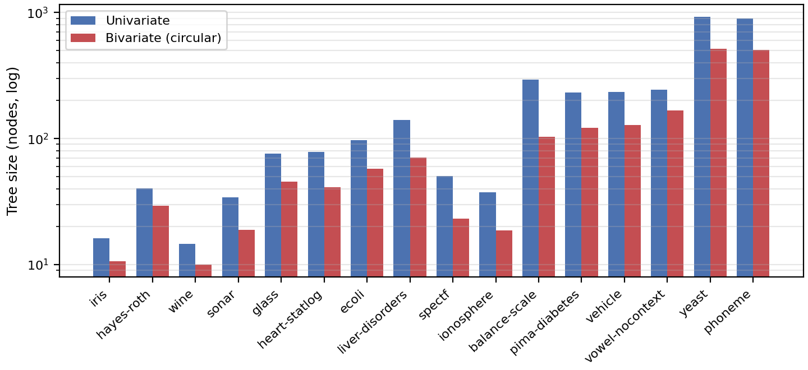
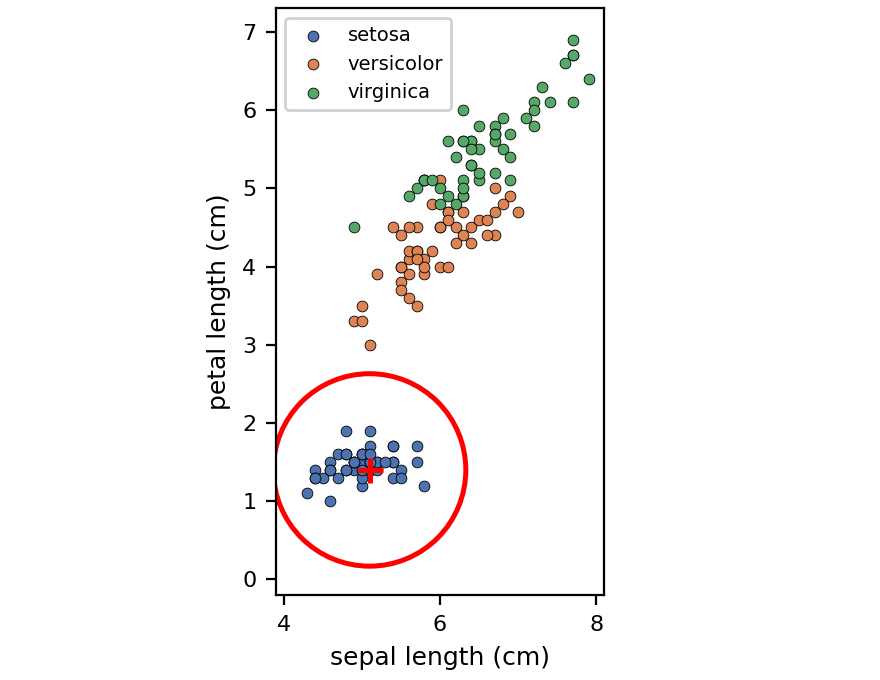

# Bivariate Circular Splits in Classification Trees

A split-finding algorithm for decision trees that tests **two attributes at once with a circle** instead of one attribute with a threshold, implemented in Java for WEKA (plus a numba-accelerated Python twin). The question: if every node can wrap a compact cluster in one curved test, do trees get smaller, and does accuracy suffer?

**Result:** trees shrink by **45%** on average and are significantly smaller on **all 16 datasets**, with **no significant accuracy loss on any of them** and a large gain where the true boundary is nonlinear (balance-scale: 77.4% to 89.1%).

## The algorithm

At a node reached by `m` instances, for every unordered pair of numeric attributes `(x_i, x_j)`:

1. **Candidate centres.** Every instance, projected onto the `(x_i, x_j)` plane, is a candidate circle centre.
2. **Radius sweep.** Sort the other instances by distance to the centre. Growing the radius only changes the split when it crosses an instance, so there are at most `m` distinct partitions per centre. Class counts are updated incrementally as each distinct-distance group moves from *outside* to *inside*.
3. **One representative per partition.** All circles that give the same inside/outside partition are equivalent; the representative radius is the midpoint `(r_min + r_max) / 2` of the two boundary distances, the 2-D analogue of a midpoint threshold.
4. **Selection.** Each candidate is scored by information gain; the best circle over all pairs and centres wins.

Cost is `O(d² · m² log m)` per node. Distances stay squared while sorting and comparing; the square root is taken only for the two boundary radii, and buffers are allocated once per attribute pair.

```
left(x)  ⟺  (x_i − c_i)² + (x_j − c_j)² < r²
```

## Verification

- **Brute-force oracle** (`experiments/validate_against_brute_force.py`): an independent reference enumerates every candidate circle explicitly and recomputes the gain from scratch. On 200 random problems (every third one on an integer grid to force distance ties) it checks the best gain, that the returned radius is the representative midpoint, and that the circle actually reproduces the reported gain. **200/200 agree.**
- **Java vs Python**: both implementations build identical trees (e.g. 11 nodes on iris).

## Results

WEKA Experimenter, 10 × 10-fold cross-validation (3,200 runs), corrected resampled paired t-test (Nadeau & Bengio) at α = 0.05.

| Dataset | n | d | Tree size: univariate | Tree size: circular | Accuracy: univariate | Accuracy: circular |
|---|---:|---:|---:|---:|---:|---:|
| iris | 150 | 4 | 16.3 | **10.6** | 93.7 | 95.3 |
| wine | 178 | 13 | 14.6 | **10.0** | 94.4 | 93.8 |
| sonar | 208 | 60 | 34.1 | **18.9** | 74.4 | 72.9 |
| heart-statlog | 270 | 13 | 78.0 | **41.0** | 74.6 | 74.1 |
| ionosphere | 351 | 34 | 37.3 | **18.6** | 88.9 | 89.5 |
| balance-scale | 625 | 4 | 294.1 | **103.5** | 77.4 | **89.1** |
| pima-diabetes | 768 | 8 | 232.5 | **121.2** | 70.1 | 69.3 |
| vehicle | 846 | 18 | 234.7 | **128.4** | 72.4 | 71.4 |
| yeast | 1484 | 8 | 919.9 | **517.0** | 51.1 | 51.7 |
| phoneme | 5404 | 5 | 896.1 | **502.9** | 87.6 | 86.9 |
| **mean (all 16)** | | | 212.9 | **116.6** | 78.1 | 78.3 |

Bold = significantly better. Full 16-dataset table in [`REPORT.pdf`](REPORT.pdf).



Circular splits are also directly visualisable. The root split on iris is a single circle that isolates *setosa*:



**Trade-off.** One circular test is harder to put into words than `x < c`; the interpretability gain comes from a much smaller tree whose every node can be drawn as a 2-D plot. The search is quadratic in instances and attributes, so it is noticeably slower than univariate splitting on the largest datasets.

## Repository layout

```
java/weka/classifiers/trees/
  BivariateNumericAttributeSplitter.java   Circular split finder (WEKA Splitter)
python/
  BivariateNumericAttributeSplitter.py     Same algorithm in Python, numba-compiled
experiments/
  run_experiments.py                       Python-side comparison: sizes, 10x10 CV, t-test
  validate_against_brute_force.py          Brute-force correctness oracle
  results.json, results_table.txt          Python-side results
figures/                                   Report figures
REPORT.pdf                                 Write-up: related work, method, results, interpretability
```

> **Not included.** The splitter plugs into a small generic tree learner (`ClassificationTree`, `Splitter`) that was supplied as a teaching scaffold, so it is not redistributed here; only the split-finding code above was written for this project. The 16 benchmark datasets (iris, wine, sonar, …) are standard public ARFF files; put them in `data/` to run the Python experiments.

## Tech

Java · WEKA (Experimenter, corrected paired t-test) · Python · NumPy · numba · Matplotlib · LaTeX

---
*Graduate coursework in interpretable machine learning, shared as a portfolio sample.*
